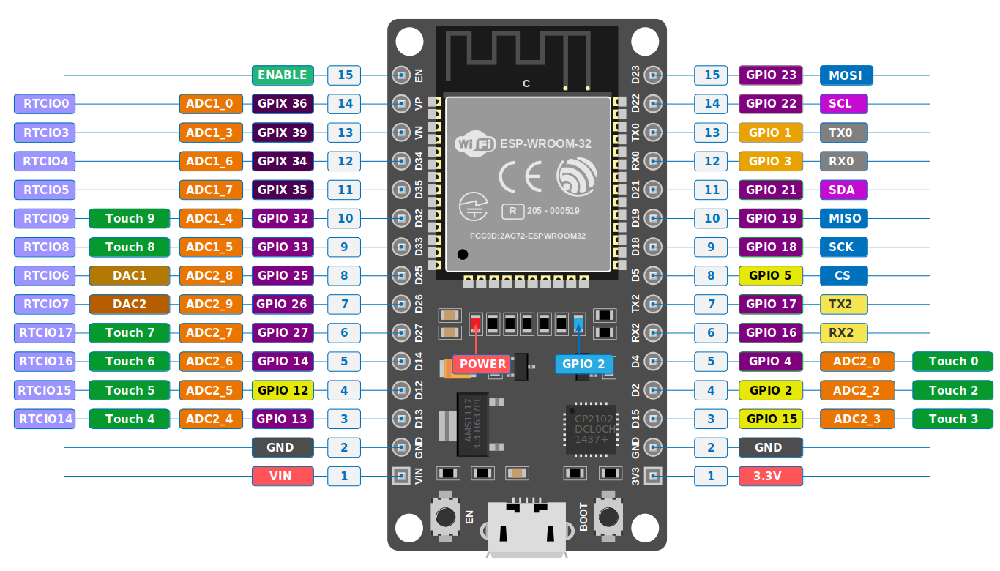

# microcomputer-constant-temperature

GPIOs 21, 22, 25, and 26

- GPIO21: "down"
- GPIO22: "up"
- GPIO25: "set"
- GPIO26: "ent"

- build: `pio run`
- flash: `pio run -t upload`
- logs: `pio device monitor`
