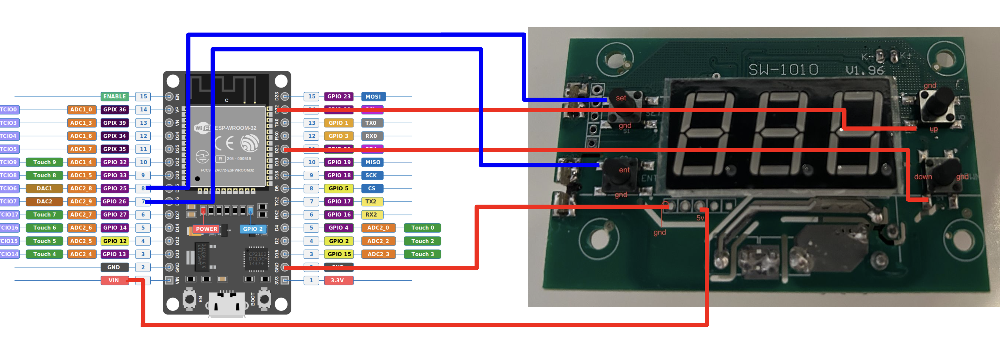

# microcomputer-constant-temperature

make your hot plate go on its own

## Background

So a while ago I bought a hot plate. It's unclear what the MPN is; it literally just says "microcomputer constant temperature" on the front.

So you can press the buttons to set different temperatures

## Info about this repo

- GPIO21: "down"
- GPIO22: "up"
- GPIO25: "set"
- GPIO26: "ent"

Heating model derived in https://www.desmos.com/calculator/reyvmryl8c


- build: `make build`
- flash: `make upload`
- logs: `make monitor`
- compiledb: `make db`

## Reproducibility

You can make this yourself if you have a microcomputer constant temperature, a soldering iron, some jumpers, and a usb cable.

 - turn it off and unplug it
 - unscrew the bottom
 - unscrew the board, unclip all the connectors, and take it out
 - solder bodges according to the wiring diagram
 - use electrical tape to tape everything that's exposed so that there are no unexpected surprises
 - screw the board back on and re clip the connectors




## Serial commands

Head over to https://terminal.spacehuhn.com/ and connect!

Times are in seconds unless noted, and temperatures are in C.

This assumes a starting temperature of 22 C.

### Store a solved peak-ramp-hold recipe

```
PRH <peak> <ramp_s> <hold_s>
```

Go to 100 C as quickly as possible:

```
PRH 100 36 60
```

Low-temp SnBi (Sn42/Bi58, melts at 138 C), straight ramp to 165 C over 120 s, 30 s at peak:

```
PRH 165 120 30
```

### Store a solved soak + reflow recipe

```
SR <soak> <ramp1_s> <hold1_s> <peak> <ramp2_s> <hold2_s>
```

Low-temp SnBi (Sn42/Bi58, melts at 138 C): soak at 100 C, peak at 165 C:

```
SR 100 90 90 165 45 30
```

Standard lead-free SAC305 (melts at 217 C): soak at 150 C, peak at 245 C:

```
SR 150 90 90 245 120 30
```

### Store a manual recipe

Each segment is a setpoint and how long to hold it, in milliseconds. 

```
BEGIN
SEG 100 10000
SEG 42 1337
SEG 100 10000
COMMIT
```

### Stored recipe

```
GET
```

```
CLEAR
```

## Running a recipe

1. Power on the plate from the wall, with USB disconnected.
2. Press SET, then ENT, then wait two seconds, then double-press ENT.
3. The ESP32 waits 1.5 s, resets the plate setpoint to 0, runs each segment, then sets it back to 0.
4. It returns to idle.

ESTOP is the power switch on the back
