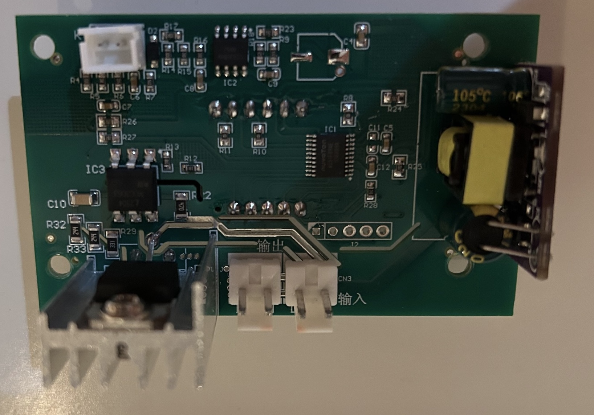
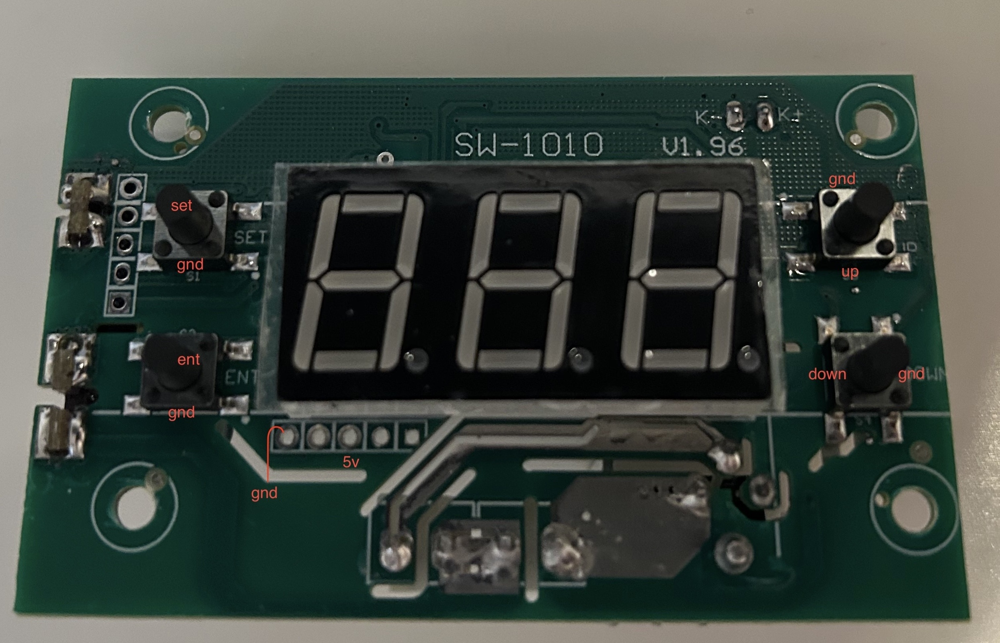

# microcomputer-constant-temperature

make your hot plate go on its own

## Background

So a while ago I bought a hot plate. It's unclear what the MPN is; it literally just says "microcomputer constant temperature" on the front. It might be the TLBZK-1010. Mine was unmarked. Nobody knows. It's quite possible that mine is an unbranded knockoff of the original TLBZK-1010.

All the description says is "hot film machine is an intelligent constant temperature heating station which suitable for any usage scenarios require forconstant \[sic\] temperature heating e.g.: PCB preheat; LED welding;Molding; Dispensing; Chemical experiment; Heat curing"

"suitable for any usage scenarios" is a pretty strong claim indeed.

So you can press the buttons to set different temperatures, but I thought it would be cool if I could do a little bit of hardware hacking and replay reflow curves, like a proper reflowing machine.

A few others have done teardowns of similar models ([1](https://hackaday.com/2022/03/10/reflow-hotplate-teardown-uncovers-the-bare-minimum/), or look on youtube).

Others ([2](https://www.e-tinkers.com/2021/07/converting-uyue-preheater-into-a-solder-reflow-hot-plate/), [3](https://www.weigu.lu/microcontroller/uyue_946_hack/index.html), [4](https://github.com/DurandA/reflow946)) have done what I've done, except they mostly do a drop-in replacement of the entire controller. 

I'm doing something a little different, which is that I'm leaving the original controller board mostly intact. In (3) they use a similar (but distinct) model of hot plate, and they cut out the chip and reimplement everything in the esp32. They also reversed a schematic, which was very useful to look at because it's quite similar to my board!

Unfortunately, the blog post ends with "Everything will be on github" and no github link.

## How it works

My approach is slightly different: All I do is hook up the esp32 to the button inputs and the 5v rail, and then it emulates button presses at superhuman speeds at a millisecond schedule.

The other thing is that ideal reflow profiles are actually trapezoids and not smooth. I collected empirical data, found that it heating curves looked mostly exponential[^1], and fitted two parameters: A maximum heating rate $r$, and an exponential time constant $k$ that seemed to be linear in terms of the setpoint[^2].

To be precise, given $$t_{k}\left(r,k\right)=\frac{S-T_{0}}{r}-\frac{1}{k}$$, I fit 

```math
y_{d}\sim\begin{cases}
T_{0}+rx_{d}, & x_{d}\lt t_{k}(r,k) \\
S-\dfrac{r}{k}e^{-k\left(x_{d}-t_{k}(r,k)\right)}, & x_{d}\ge t_{k}(r,k)
\end{cases}
```

You can see this all in Desmos! https://www.desmos.com/calculator/reyvmryl8c

That's the forward model: predict time-series temperature given setpoint $S$ and current temperature $T_0$. Then I have a greedy optimizer that runs on the esp32 to calculate this when you bake a recipe.

On the PCB, genuinely the only silkscreen markings other than footprints and reference designators were "K+/K-" and "输入/输出"

The weigu.lu source ((3) above) writes, "A 5 pin header (not soldered) is connected to the 20 pin microcontroller. The µC is not labeled and I thought after a little research we have an STM8103F3. Basil wrote me that this was not likely, as ST parts always have markings and this chip doesn't. He also wrote the chip is highly likely one of many Asian-brand STM8S003-pin-compatible MCUs that are typically based on 8051 or ARM Cortex M0+ processors."

Well, on my rev of the board the chip did have markings on it, and it's a Nuvoton MS51FB9AE ([datasheet](https://www.nuvoton.com/export/resource-files/DS_MS51FB9AE_MS51XB9AE_MS51XB9BE_EN_Rev1.pdf)). The MS51FB9AE is in fact an STM8S003 pin compatible 8051 Asian-brand MCU. It's possible that weigu's mystery chip is the MS51FB9AE as well. 


Here's the board if you're curious:

|     |     |
| --- | --- |
|  |  |

[^1]: There's an undulating pattern in the residuals, which isn't exactly ideal, but the model works well enough for my needs
[^2]: So I only collected time-series data for three heating curves, so of course everything looks pretty linear, but I think it'll work.

## Info about this repo

- build: `make build`
- flash: `make upload`
- logs: `make monitor`
- compiledb: `make db`

## Reproducibility

You can make this yourself if you have a microcomputer constant temperature, a soldering iron, some jumpers, and a usb cable.

 - turn it off and unplug it
 - unscrew the bottom
 - unscrew the board, unclip all the connectors, and take it out
 - solder bodges according to the wiring diagram
 - use electrical tape to tape everything that's exposed so that there are no unexpected surprises
 - screw the board back on and re clip the connectors

Note:
 - GPIO21: "down"
 - GPIO22: "up"
 - GPIO25: "set"
 - GPIO26: "ent"

Wiring diagram: 


## Serial commands

Head over to https://terminal.spacehuhn.com/ and connect!

Times are in seconds unless noted, and temperatures are in C.

This assumes a starting temperature of 22 C.

### Store a solved peak-ramp-hold recipe

```
PRH <peak> <ramp_s> <hold_s>
```

Go to 100 C as quickly as possible:

```
PRH 100 36 60
```

Low-temp SnBi (Sn42/Bi58, melts at 138 C), straight ramp to 165 C over 120 s, 30 s at peak:

```
PRH 165 120 30
```

### Store a solved soak + reflow recipe

```
SR <soak> <ramp1_s> <hold1_s> <peak> <ramp2_s> <hold2_s>
```

Low-temp SnBi (Sn42/Bi58, melts at 138 C): soak at 100 C, peak at 165 C:

```
SR 100 90 90 165 45 30
```

Standard lead-free SAC305 (melts at 217 C): soak at 150 C, peak at 245 C:

```
SR 150 90 90 245 120 30
```

### Store a manual recipe

Each segment is a setpoint and how long to hold it, in milliseconds. 

```
BEGIN
SEG 100 10000
SEG 42 1337
SEG 100 10000
COMMIT
```

### Stored recipe

```
GET
```

```
CLEAR
```

## Running a recipe

1. Power on the plate from the wall, with USB disconnected.
2. Press SET, then ENT, then wait two seconds, then double-press ENT.
3. The ESP32 waits 1.5 s, resets the plate setpoint to 0, runs each segment, then sets it back to 0.
4. It returns to idle.

ESTOP is the power switch on the back
